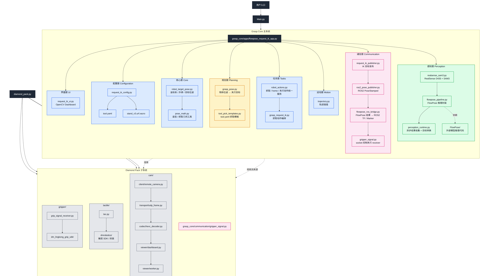

# Daimon Gripper Tools

夹爪控制、远程相机预览和触觉 dashboard。日常启动入口保留在根目录与 `examples/`，实现集中在 `src/daimon_control/`，底层 SDK 保持独立。



## 安装

在项目根目录创建或更新环境：

```bash
conda env create -f environment.yml
conda activate daimon-gripper
# 已有环境：conda env update -f environment.yml --prune
```

SDK 迁入 `sdks/` 后，已有环境需重新注册两个 SDK 和应用包的 editable 路径，无需重新下载依赖：

```bash
python -m pip install --no-deps --no-build-isolation -e sdks/dm_gripper_py -e sdks/dm_gripper_tac_py -e .
```

手动安装完整环境：

```bash
python -m pip install -r requirements.txt
python -m pip install -e sdks/dm_gripper_py
python -m pip install -e sdks/dm_gripper_tac_py
python -m pip install -e .
```

`requirements.txt` 为统一依赖清单。根目录与 `examples/` 中的启动脚本均导入已安装的应用包，请先完成上述安装。editable 安装后修改源码会直接生效，也可从其他目录使用 `daimon-*` 命令。

GPU 触觉安装见 [触觉 SDK 说明](sdks/dm_gripper_tac_py/README.md) 和 `sdks/dm_gripper_tac_py/environment-gpu.yml`。SDK、模型和 TensorRT/CUDA 库位于 `sdks/` 下，SDK 内部结构保持不变。

## 日常使用

server 默认从根目录的 [gripper_server_config.json](gripper_server_config.json) 读取全部运行参数：

```bash
python gripper_server.py
```

启动完成后会自动打开浏览器。图像传输默认关闭，页面会显示相机未启用；需要查看左右夹爪图像时，将配置中的 `image_streams.enabled` 设为 `true`，或使用 `python gripper_server.py --enable-image-streams` 启动。默认地址为 `http://127.0.0.1:8020/`；另一台电脑可访问 `http://SERVER_IP:8020/`，端口以配置为准。网页复用 server 已有视频流，不额外占用相机会话。

可在 `server.open_browser` 配置中关闭自动打开，或临时使用：

```bash
python gripper_server.py --no-open-browser
```

无桌面环境时可从其他电脑手动打开该地址。网页会提示相机未启用、等待图像或连接异常，并自动重连。

也可在其他终端启动原有夹爪 GUI 和 OpenCV 相机查看器：

```bash
python gripper_gui_client.py --server-url http://127.0.0.1:8020
python img_client.py --host 127.0.0.1
```

远端查看时，把 `127.0.0.1` 换为 server 所在电脑的 IP。默认夹爪服务端口 `8020`，左右相机 HTTP 端口 `8021/8022`；具体以配置为准。

位置、速度、力矩控制值均为 `0..1`；位置 `0=闭合`、`1=张开`。速度、力矩 `0.5` 对应 SDK 的 `50`，低于 `0.1` 按 SDK 最低档执行，`0` 不代表停止或断力。SDK 原生测试脚本仍使用 SDK 单位。

| 用途 | 源码命令 | 安装后的命令 |
|---|---|---|
| 夹爪与相机服务 | `python gripper_server.py` | `daimon-server` |
| 远程夹爪 GUI | `python gripper_gui_client.py` | `daimon-gripper-gui` |
| 相机 HTTP 查看器 | `python img_client.py` | `daimon-image-viewer` |
| 单手 dashboard | `python examples/dashboard_single.py` | `daimon-dashboard-single` |
| 双手 dashboard | `python examples/dashboard_dual.py` | `daimon-dashboard-dual` |

独立夹爪、相机和触觉示例见 [examples/README.md](examples/README.md)。双手 dashboard 的外部夹爪接收器未包含在本仓库中，使用限制见 [故障排查](docs/troubleshooting.md)。

## 目录结构

```text
.
├── gripper_server.py             # 兼容启动入口
├── gripper_gui_client.py         # 兼容启动入口
├── img_client.py                 # 兼容启动入口
├── gripper_server_config.json    # server 全部运行配置
├── pyproject.toml               # 应用包、依赖及命令入口
├── requirements.txt
├── environment.yml
├── src/daimon_control/
│   ├── config.py                # 配置读取、校验和命令行覆盖
│   ├── gripper.py               # server 与直接控制的 SDK 适配器
│   ├── units.py                 # 0–1 与 SDK 单位转换
│   ├── camera.py                # 相机 SDK 访问
│   ├── server/                  # 路由、命令模型、MJPEG 服务
│   ├── clients/                 # 远程 GUI、HTTP 查看器、直接控制 GUI
│   └── dashboards/              # 单/双手整合界面
├── examples/                    # 简短启动入口与兼容入口
├── sdks/
│   ├── dm_gripper_py/           # 夹爪 SDK 和原生测试
│   ├── dm_gripper_cam_py/       # 相机 SDK、协议、解码器和原生测试
│   └── dm_gripper_tac_py/       # 触觉 SDK、模型与原生实验脚本
├── deploy/camera/               # 在相机设备上部署的服务端更新文件
├── docs/                        # 文档及架构图 pipeline.png
└── tests/
```

启动入口直接导入已安装的应用包，不再使用 `_bootstrap.py` 或手工修改模块搜索路径。Dashboard 统一使用 `examples/dashboard_single.py` 和 `examples/dashboard_dual.py`，公共夹爪界面实现位于 `src/daimon_control/clients/direct_control.py`。

## 文档与验证

- [配置说明](docs/configuration.md)
- [HTTP / WebSocket 接口](docs/api.md)
- [相机与 dashboard 故障排查](docs/troubleshooting.md)
- [模块职责与旧路径迁移表](docs/structure.md)
- [相机设备端部署](deploy/camera/README.md)

从项目根目录运行无需硬件的回归测试：

```bash
python -m unittest discover -s tests -v
```

测试覆盖配置读取、归一化控制、模拟 API、模块导入和命令入口；真实夹爪动作、相机取流和触觉推理需在设备环境单独验证。
